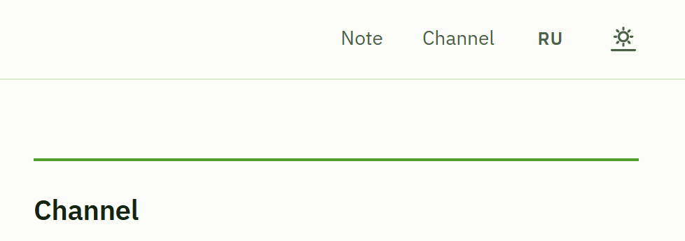
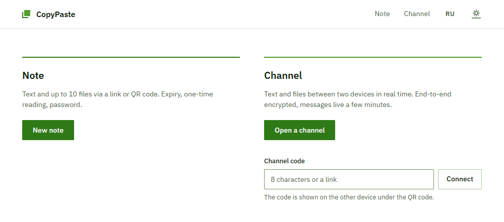
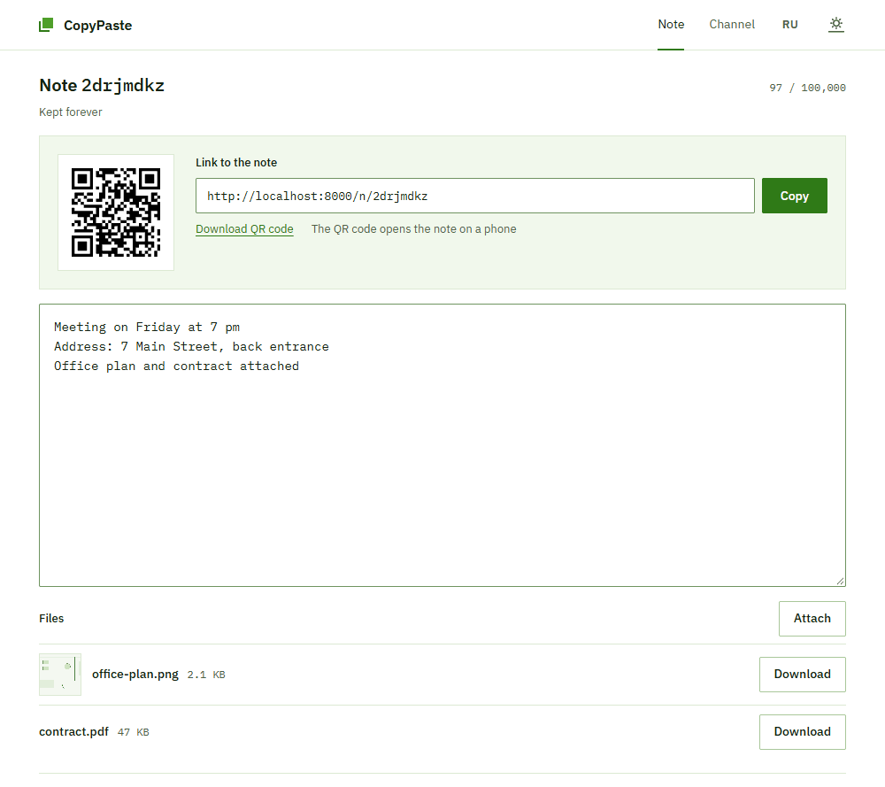
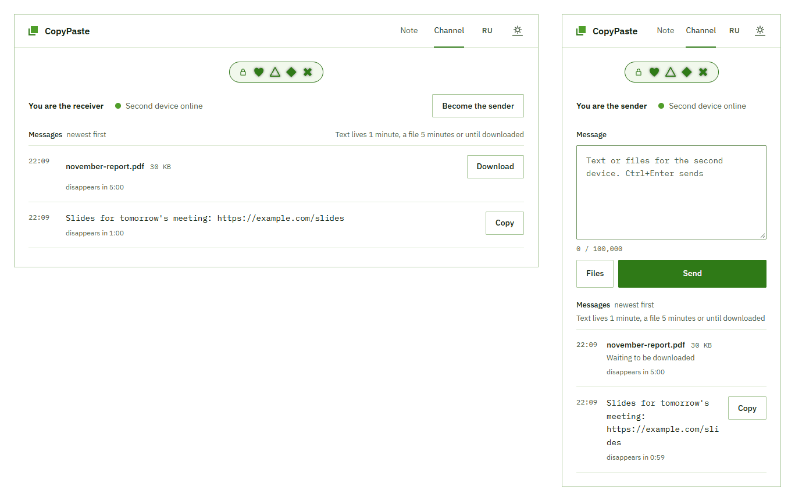

# CopyPaste

[Русский](README.md) · **English**

A service for sharing text and files between devices (FastAPI + PostgreSQL).

Two modes:

- **Notes**: save text and up to 10 files, share them via a link or a QR code. You can set an
  expiry, delete the note after the first reading, or protect it with a password; then the text
  and files are stored encrypted.
- **Channels**: a real-time clipboard between two devices. One device opens a channel, the other
  joins via a QR code, a link or an 8-character code. The sender types text or drops files, the
  receiver sees a feed: text has a "Copy" button, a file has "Download". The roles can be swapped.
  Channel text and files are end-to-end encrypted in the browser: the server relays only
  ciphertext, and matching verification shapes on the two devices confirm that nobody swapped
  the keys.

Files are attached with a button, by drag and drop or by pasting from the clipboard (Ctrl+V), with
a progress bar.

The theme follows the system at first; the button in the header switches between light and dark.
The choice is kept in `localStorage` (`copypaste:theme`); without it the theme follows the system
and changes along with it. `static/prefs.js` sets the theme in `<head>` before the styles, so the
page never flashes in the wrong colours.



The site is in Russian and English; the button in the header switches the language in place,
without a reload, so a draft in the editor or a one-time note that was just read is not lost. The
choice is kept in `localStorage` (`copypaste:lang`); without it the site opens in Russian. Only
what the user sees is translated: the server answers with error codes, and the frontend supplies
the texts for them.

Russian is the source language: it stays in `index.html` and in the code, and
`static/i18n-en.js` is a "Russian → English" dictionary. `static/i18n.js` finds the static text
of the page by itself; text from the code is set via `setText`/`msg` with `{params}` and plurals
such as `{n:файл|файла|файлов}` (`{n:file|files}` in English). Adding a new string to the
dictionary is enough: `make test-js` checks that every Russian string has a translation with the
same parameters and that the dictionary has nothing extra.

## Screenshots

The images follow your GitHub theme: in dark mode you see the dark screenshots.

**Home**

<picture>
  <source media="(prefers-color-scheme: dark)" srcset="docs/screenshots/en/home-dark.png">
  
</picture>

**Note** with a link, a QR code and files

<picture>
  <source media="(prefers-color-scheme: dark)" srcset="docs/screenshots/en/note-dark.png">
  
</picture>

**Channel**: the receiver's computer and the sender's phone, with matching shapes in the capsules

<picture>
  <source media="(prefers-color-scheme: dark)" srcset="docs/screenshots/en/channel-dark.png">
  
</picture>

## Running

```bash
cp .env.example .env   # fill in your own values
make up
```

`FILES_SIGNING_SECRET` in `.env` is required (at least 32 characters); the app does not start
without it. To generate one:

```bash
python -c "import secrets; print(secrets.token_urlsafe(32))"
```

- app: http://localhost:8000
- API docs: http://localhost:8000/docs

A channel encrypts messages in the browser, and WebCrypto works only over HTTPS or on
`localhost`. So at an address like `http://192.168.x.x:8000` notes open on a phone, but a channel
does not. A channel on a phone needs HTTPS, for example a tunnel to `localhost:8000`; its address
is what ends up in the QR code.

## Commands

| Command | What it does |
|---|---|
| `make up` / `make down` | start / stop the containers |
| `make migrate` | apply migrations |
| `make revision m="..."` | create a migration (autogenerate) |
| `make test` | tests; pass arguments via `args="-k ws"` |
| `make test-js` | channel encryption and translation dictionary tests (`node --test`) |
| `make lint` | ruff check, ruff format --check, mypy |
| `make format` | fix what ruff can fix by itself |

All commands except `make test-js` run inside the `app` container, so it must be running.
`make test-js` runs on your machine: it needs Node 22 or newer, no packages.

## Architecture

Containers:

- `db`: PostgreSQL 16;
- `redis`: Redis 7 without persistence to disk: password attempts, file keys for a while after a
  password is entered, the upload limit;
- `app`: FastAPI under uvicorn: pages, REST API and WebSocket;
- `scheduler`: APScheduler (`AsyncIOScheduler`): cleanup of notes and channels, the file
  collector, disk/DB reconciliation.

File bytes live in the named volume `filedata` (`/data/files`), shared by `app` and `scheduler`.
Not in the project folder: it is mounted into the container and would end up in git.

```
app/
  api/notes/, api/channels/,  HTTP and WebSocket handlers: request parsing and response only
  api/files/
  services/                   business logic; flush, but no commit
  db/                         SQLAlchemy models and the connection
  storage/                    where file bytes live: interface and on-disk implementation
  realtime/                   who is connected to which channels, rate limiting
  security/                   what lives in Redis: password attempts, file keys, upload limit
  schemas/                    Pydantic schemas, including WebSocket events
  utils/                      encryption, signed links, Range, file type, QR, tokens
  jobs/, scheduler.py         periodic cleanup
  static/                     frontend without a build step: index.html, app.js, channel.js,
                              files.js, channel-crypto.js (channel keys), channel-keystore.js
                              (IndexedDB), prefs.js (theme and language), i18n.js and
                              i18n-en.js (translation)
  static/fonts/               IBM Plex Sans and Mono (SIL OFL 1.1, license texts alongside)
```

## Async

The whole app is asynchronous: handlers, WebSocket and scheduler jobs run in one event loop.
PostgreSQL goes through `AsyncSession` and psycopg 3 (the same `DATABASE_URL`), Redis through
`redis.asyncio`, Alembic migrations through an async engine.

### Transactions

- HTTP handlers get a session from the `DbSession` dependency (`get_db`). The commit happens
  after the handler but before the response is sent (`scope="function"`); on error, a rollback.
- WebSocket, file upload and download use a short transaction per step:
  `run_db(factory, fn)`. A slow transfer does not hold a DB connection.
- Scheduler jobs use `async with session_factory() as db, db.begin()`.

### Nothing loads lazily

Accessing an unloaded relationship or an expired attribute is a hidden query. In async code it is
impossible and fails with `MissingGreenlet`, so everything needed is loaded explicitly:

- `expire_on_commit=False`: objects do not expire after a commit;
- the `Participant.channel` relationship is `lazy="raise"`; the channel is fetched via
  `joinedload`;
- after an `UPDATE` the object is re-read via `refresh()`, values computed by the DB itself via
  `RETURNING`.

In tests a hidden lazy load is an `ImplicitLoadError` with the query text, not a
`MissingGreenlet` somewhere deep inside SQLAlchemy.

### What runs in threads and why

There is one event loop: while it is busy, every request and every channel waits. So whatever
keeps the CPU busy or waits for the local disk goes to a thread, while the DB, Redis and
WebSocket do not occupy threads.

| What | Why | How |
|---|---|---|
| Argon2: creating and opening a password-protected note | ~0.1 s of CPU per attempt | `crypto.in_kdf_thread`, at most `KDF_MAX_CONCURRENT` at a time |
| encrypting note files, decrypting on download | CPU and disk | `run_in_threadpool`; Starlette reads the response body in a thread |
| writing uploads, reading and deleting files | the local disk has no non-blocking API | `anyio.Path`, `run_in_threadpool`, `anyio.to_thread` |
| QR code | CPU | `run_in_threadpool` |
| disk/DB reconciliation in `scheduler` | walks over all files | `anyio.to_thread`, in batches |

- Creating a note with a password and files is protected from cancellation
  (`CancelScope(shield=True)`): otherwise a client dropping the request between the commit and
  the cleanup would leave the plaintext original on disk.
- The Redis pool waits (`BlockingConnectionPool`): under a burst of requests a command waits up
  to 1 s for a free connection instead of failing. A regular pool would refuse at once, so
  passwords would answer 503 and uploads would fall back to the in-memory limit.

## Notes API

| Method and path | What it does |
|---|---|
| `POST /api/notes` | create a note; `file_ids` is up to 10 ids from `POST /api/files`, then text is optional |
| `GET /api/notes/{slug}` | get a note with file links (a one-time note comes without text and without links) |
| `POST /api/notes/{slug}/read` | read; a one-time note is deleted, its files get one-time links |
| `PUT /api/notes/{slug}` | change the text or the expiry (files do not change) |
| `DELETE /api/notes/{slug}` | delete |
| `POST /api/notes/{slug}/unlock` | open a password-protected note: `{"password": "..."}` → text and file links |
| `POST /api/notes/{slug}/delete` | delete a password-protected note, the password goes in the body |
| `GET /api/notes/{slug}/qr` | QR code with the link (SVG) |

For a password-protected note `GET` returns `has_password: true`, the expiry and file names, but
no text and no links, while `read`, `PUT` and `DELETE` answer 409. The password is sent only in
the request body: addresses end up in logs.

## Password-protected notes

The password is set on creation (`password`, 4–128 characters). A forgotten password cannot be
recovered, changed or removed. Such a note cannot be edited and can be deleted only with the
password. A one-time note with a password burns after the correct password; a wrong one does not
touch it.

### Encryption

```
password --NFC--> Argon2id(salt, t, m, p) --> KEK (32 bytes, never stored)
                                               |
DEK (32 random bytes) ---AES-GCM(KEK)--------> wrapped_key                in the DB
  |
  +---AES-GCM---> ciphertext                                              in the DB, text = ''
  +---AES-GCM in 64 KiB chunks---> file bytes                             on disk
```

- **Envelope encryption.** The password encrypts not the text but a random note key (DEK). So
  files are encrypted with the same key, and changing the password in the future only needs the
  DEK to be re-encrypted.
- **Checking the password is decrypting.** There is no separate hash: a wrong password gives a
  different KEK, and the AES-GCM tag does not match. A hash next to it would be one more target
  for brute force.
- **Argon2id** with t=10, 64 MiB, p=4: about 0.1 s per attempt (0.35 s on a single core). The
  parameters are stored in every note: they can be made stricter, and old notes will open with
  their own. At most `KDF_MAX_CONCURRENT` requests derive a key at the same time, otherwise
  brute force would eat the server's memory.
- **AAD** binds the ciphertext to the note and its purpose: the text of one note cannot be
  planted into another, and the encrypted key cannot be passed off as text.
- **CHECK constraints in the DB:** a note is never "half" encrypted, and an encrypted note has an
  empty `text`.

### Attempts and lockout

Wrong-password counters live in Redis, each updated atomically by one Lua script.

| Limit | Default | Protects against |
|---|---|---|
| address | 10 wrong in 15 minutes → frozen for 15 minutes | one attacker trying many notes |
| note | 5 wrong in a minute → locked for a minute | guessing one note's password from many addresses |

- The freeze is checked before Argon2: a frozen address does not spend the server's memory and
  CPU.
- 403 means a wrong password, `detail.attempts_left` says how many attempts are left. If this
  error triggered the freeze, it already carries `Retry-After`. After that: 429 with
  `Retry-After`.
- The correct password resets the note's counter, but not the address's.
- If Redis is down, `/unlock` and `/delete` answer 503: without counters brute force would be
  unlimited. Everything else works without Redis.
- 422 does not echo the entered password. By default FastAPI puts the value into the `input`
  field, even for `SecretStr`, so validation errors have their own handler.
- The response with decrypted text has `Cache-Control: no-store`.

### Files of a password-protected note

- Before the password is entered, files have no links, only a name and a size. After it, links
  for `PROTECTED_FILE_URL_TTL_SECONDS`; for a one-time note, one-time links.
- The bytes are encrypted when the note is created: a file is uploaded earlier, when there is no
  password yet. The encrypted copy is written under a new storage key, the DB row switches to it
  in the same transaction, and the plaintext original is erased after the commit. A rollback or a
  crash leaves only an extra file on disk, which the disk/DB reconciliation removes.
- A file is encrypted in 64 KiB chunks, each with its own tag. The chunk nonce is 8 random bytes
  of the file plus the chunk number; the AAD holds the file id, the number and a "last" flag.
  Chunks cannot be reordered, taken from another file or cut off at the end.
- After `/unlock` the note key sits in Redis for `FILE_KEY_CACHE_SECONDS`. The link carries only
  the `key_id` of that entry, and it is part of the link signature; the key itself gets neither
  into the address nor into logs. A link does not outlive the entry: once it expires, 403, and the
  note has to be opened with the password again.
- Download decrypts on the fly, `Range` reads only the needed chunks from disk (206, 416,
  `If-Range`). A tampered chunk produces an error, not garbage; if this happens mid-transfer, the
  connection breaks before `Content-Length`.

## Files

### Upload

| Method and path | Who can |
|---|---|
| `POST /api/files?name=...` | anyone: a file for a note |
| `POST /api/channels/{slug}/files` | the channel sender after the key exchange (409 otherwise), token in `X-Participant-Token`; the body is the file encrypted in the browser, no name in the request |

- The request body is the raw file bytes, no multipart. The server reads them as a stream and
  cuts off at `FILE_MAX_SIZE_BYTES` + 1 byte (413) without waiting for the end:
  `Content-Length` may be missing or forged.
- The type is detected from the first bytes; the client's header is not trusted. Only PNG, JPEG,
  GIF and WebP count as images and get a preview; everything else is
  `application/octet-stream`.
- A channel file is ciphertext: its type is always `application/octet-stream`, there is no
  preview, and its name on the server is `file`. The limit is larger by a 16-byte tag per 64 KB
  chunk, see "File encryption".
- Response: `id`, `name`, `size`, `content_type`, `is_image`. The file waits to be attached for
  `PENDING_UPLOAD_TTL_SECONDS` (to a note via `file_ids`, to a channel via the `send_file` event).
- 429: too many uploads from one address; 507: the `FILES_MAX_TOTAL_BYTES` quota is used up.

### Download and confirmation

File links are issued by the server in note responses and channel events; they are not built by
hand:

- `download_url`: `GET /api/files/{id}?exp=...&sig=...`. An HMAC-SHA256 signature with an
  expiry, checked before touching the DB. The file is always served as a download, with
  `nosniff` and `Content-Security-Policy: sandbox`; resuming (`Range`) is supported. Links to
  files of a password-protected note also carry `key_id`, see "Password-protected notes";
- `preview_url`: the same with `inline=1`, only for images;
- `received_url`: only for one-time files: `POST` here once the file is fully downloaded.

**One-time files are deleted on the client's confirmation, not on the fact of sending.** The
server only sees that it handed the bytes to the kernel: a file of a few megabytes goes into the
socket buffers in milliseconds, even if the client received only hundreds of kilobytes before
the connection dropped. So the page downloads such files itself (`fetch`, with progress),
resumes from the same byte after a drop, and only then calls `received_url`. Without a
confirmation the file lives out its term and is removed by the collector.

### Lifecycle

| File | How long it lives |
|---|---|
| uploaded, not attached to anything | `PENDING_UPLOAD_TTL_SECONDS` |
| in a note | as long as the note |
| in a one-time note after reading | until receipt is confirmed, but no longer than `BURN_NOTE_FILES_WINDOW_SECONDS` |
| in a channel | until receipt is confirmed, but no longer than `CHANNEL_FILE_TTL_SECONDS` |

A file row is linked to its owner (a note or a message) via `ON DELETE SET NULL`. When the owner
is deleted, the file becomes "ownerless", and the collector (`run_files_gc`, every
`FILES_GC_INTERVAL_SECONDS`) deletes both the row and the bytes. The rest of the code knows
nothing about the disk.

Order of operations: upload writes the bytes first, then the DB row; deletion removes the row
first, then the bytes. A crash between the steps leaves only an extra file on disk, which the
disk/DB reconciliation (`run_disk_sweep`) removes every `FILES_DISK_SWEEP_INTERVAL_SECONDS`,
together with unfinished uploads.

### Storage and moving to MinIO

The code works with the `FileStorage` interface (`app/storage/base.py`); there is one
implementation for now, `LocalFileStorage`: writing to a temporary `.part`, an atomic rename to
a key like `ab/cd/<hex>`. The key is generated by the server; the user's file name never gets
into the path.

MinIO/S3 needs an `S3FileStorage` class and a `minio` container. Regular files can be served by
redirecting to a presigned S3 link, and uploads can move to presigned PUT: the "upload → attach"
scheme is already ready for that. Services, API and frontend do not change.

### Security

- previews only for PNG/JPEG/GIF/WebP detected by content; SVG and HTML are always downloaded
  and never executed on our domain;
- links are signed and time-limited; only the receiver gets links to a channel file, the sender
  sees their own file without links;
- only your own upload, and only one meant for a channel, can be sent to a channel
  (`uploaded_by_id`, `origin`); attaching to a note is a single conditional `UPDATE`, so one file
  cannot end up in two notes;
- limits: file size, upload rate, total storage quota;
- files of password-protected notes are stored encrypted on disk; channel files arrive already
  encrypted by the browser.

## Channels

### REST

| Method and path | What it does |
|---|---|
| `POST /api/channels` | create a channel; the creator is the receiver. Response: `slug`, `token`, `role` |
| `POST /api/channels/{slug}/join` | join with `{"key_commitment": ...}`, the fingerprint of the device key; 404: no such channel, 409: already two participants, 422: no fingerprint |
| `GET /api/channels/{slug}` | channel state, as in the `state` event; token in the `X-Participant-Token` header |
| `GET /api/channels/{slug}/qr` | QR code with a link to the channel page (SVG) |
| `POST /api/channels/{slug}/files` | upload a file (sender only), see "Files" |

The participant token is issued once; the DB stores only its SHA-256. The frontend keeps the
token in `localStorage`, so after a page reload you stay the same participant.

### WebSocket `/ws/channels/{slug}`

All messages are JSON with a `type` field. The token is sent in the first message, not in the
address: addresses end up in logs.

Client → server:

| Event | Fields | Who can |
|---|---|---|
| `auth` | `token` | as the first message, within `WS_AUTH_TIMEOUT_SECONDS` |
| `public_key` | `key`: the device's public key | once, in the order from "Key exchange" |
| `send` | `payload`: encrypted text (29–300,028 bytes, see "Text encryption") | the sender only, after the key exchange |
| `send_file` | `file_id`: the id of your upload, `payload`: the encrypted file description (29–2,076 bytes) | the sender only, after the key exchange |
| `become_sender` | none | the receiver only |

Server → client:

| Event | Fields | When |
|---|---|---|
| `state` | `role`, `peer_joined`, `peer_online`, `messages`, `key_sent`, `peer_key_commitment`, `peer_public_key` | right after `auth`, always first |
| `peer_joined` | `key_commitment` | the second device joined the channel, to the creator |
| `peer_key` | `key` | the other device sent its key |
| `message` | `id`, `kind` (`text`/`file`), `payload` (text or file description), `file`, `created_at`, `expires_at` | a new message, to both participants; file links only for the receiver |
| `file_downloaded` | `message_id` | the receiver confirmed the download, to both |
| `roles_changed` | `role` | after `become_sender`, each gets their new role |
| `peer_status` | `online` | the second device connected or disconnected |
| `error` | `code`, `detail` | `invalid_event`, `not_sender`, `not_receiver`, `file_not_found`, `rate_limited`, `already_authenticated`, `keys_not_ready`, `key_out_of_order`, `key_already_sent`, `key_mismatch` |
| `channel_closed` | `reason` | the channel is closed; then the connection closes with code 4410 |

Close codes:

| Code | Reason |
|---|---|
| 1009 | message larger than `WS_MAX_MESSAGE_BYTES` |
| 4401 | no `auth` in time, or the token does not fit the channel |
| 4404 | the channel does not exist or is already closed |
| 4409 | this participant connected in another tab, the old connection is closed |
| 4410 | the channel closed due to inactivity |

The same message may arrive both in `state` and as a separate `message` event; the client drops
duplicates by `id`.

### Key exchange

Each device creates an ECDH P-256 key pair (WebCrypto); the server stores only the public keys
and relays them to the other device. A key is an uncompressed point (65 bytes), the fingerprint
is its SHA-256; in JSON both travel as base64url without `=`. The order is strict:

1. The joining device joins (`join`) with the fingerprint of its key; the creator receives it in
   `peer_joined` or in `state`.
2. The creator sends `public_key`, only after the fingerprint, otherwise `key_out_of_order`.
3. The joining device receives `peer_key` and sends its own `public_key`, only after the
   creator's key and only the one matching the fingerprint (`key_mismatch`).

Each key is accepted once (`key_already_sent`), and `send` and `send_file` answer
`keys_not_ready` before the exchange. The order is what makes the visual check work: both sides
commit to their key before seeing the other one, so the server cannot pick substitute keys that
would make the verification shapes match on both devices. If the creator is offline when the
second device joins, the second device waits: the creator does step 2 when it comes back.

In the browser (`static/channel-crypto.js`, `static/channel.js`):

- the private key is created non-extractable and stored in IndexedDB along with the role in the
  exchange, so the channel survives a page reload. It is deleted together with the token when the
  channel is closed;
- HKDF-SHA-256 derives two AES-256-GCM keys from the ECDH shared secret, one for text and one for
  files. HKDF takes the channel code and both public keys in the order "creator, joiner";
- the shapes are the first 20 bits of the SHA-256 of both keys: 4 shapes of 5 bits each (16 forms,
  filled or outline). A key substituted in the middle guesses them with a chance of 1 in
  1,048,576. The shapes glow in a capsule pinned to the top of the screen; the hint about them
  pops up once per device by itself (`copypaste:shapes-hint-seen` in `localStorage`), after that
  a tap on the capsule opens it;
- the creator checks the other device's key against the fingerprint and reveals its own key to
  one fingerprint per channel. A different fingerprint, or a different key of the other device
  after a reconnect, leads to the "Keys do not match" screen, and the device forgets the channel.

### Text encryption

The browser encrypts text with the text key; the server stores and relays only the `payload`:
a 12-byte random nonce, the ciphertext and the 16-byte AES-GCM tag, base64url without `=` in
JSON. The AAD includes the channel code and the message kind, so a ciphertext cannot be moved to
another channel or passed off as a file description. A damaged or foreign message will not
decrypt; the feed shows "Could not decrypt the message".

The server checks only the length: from 29 bytes (non-empty text) to 300,028. The input field
limits text to 100,000 UTF-16 characters, and in UTF-8 such a character takes at most 3 bytes.
In base64 that is about 400 KB, comfortably below `WS_MAX_MESSAGE_BYTES`.

The sender is not part of the AAD: the feed does not show who sent a message, and the roles
change, so such a binding would protect nothing. There is no replay protection either: the
server can send an old message again, but it cannot forge or alter it.

### File encryption

The browser encrypts a file before upload with the file key, in 64 KB chunks, in the same format
as files of password-protected notes: the chunk nonce is 8 random bytes of the file plus the
chunk number, and the AAD also holds the channel code and a "last chunk" flag. Chunks cannot be
reordered, moved into another file or cut off: a file cut exactly at a chunk boundary will fail
the tag check. Each chunk is 16 bytes of tag longer than the original, so the server accepts up
to `FILE_MAX_SIZE_BYTES` plus 16 bytes per chunk.

The name, size and nonce of the file go into `send_file` as an encrypted description; it is a
message of kind "file", and the AAD keeps it from being passed off as text. The browser cuts the
name to 255 characters, so the description fits into 2 KB. The server knows only the size of the
ciphertext.

The receiver downloads the file as before, resuming with `Range`, and decrypts it once it has
arrived in full: only then is it clear that no chunk was tampered with and the file was not cut.
The file is saved under its real name, and receipt is confirmed (`received_url`) only after a
successful decryption. If the tag does not match, the card says "The file is damaged or tampered
with", nothing is saved, and the file can be downloaded again. A decrypted file is never opened
in a tab: a blob link works on behalf of the site, and HTML from the file would run as its code.

The encrypted copy of a file is kept in browser memory before upload: only Chromium supports
streaming request bodies in `fetch`. On download the file is assembled in memory anyway; for
50 MB that is fine even on a phone.

### Lifecycle

- text lives for `MESSAGE_TTL_SECONDS`, a file for `CHANNEL_FILE_TTL_SECONDS` or until receipt is
  confirmed;
- a channel closes if nothing was sent in it and the roles were not changed for
  `CHANNEL_IDLE_TIMEOUT_SECONDS`. The time counts from `last_activity_at` in the DB: a timer in
  `app` sleeps exactly until that moment and closes the channel, and if there was activity, it
  goes back to sleep;
- `scheduler` deletes expired messages and inactive channels (participants and messages
  cascade) every `CHANNEL_CLEANUP_INTERVAL_SECONDS`. This also covers an `app` restart, which
  loses the in-memory timers.

Actions in a channel are serialized by locking the channel row (`SELECT … FOR UPDATE`): two
simultaneous joins cannot take one slot, neither text nor a file goes out while the roles are
being swapped, a second device key cannot overwrite the first, and the cleanup cannot delete a
channel from under a message being sent. There are tests for this in
`tests/test_channels_concurrency.py`.

## Limitations

- **A single `app` process.** The list of channel connections and the channel close timers live
  in process memory. Several workers or replicas would need a shared broker (for example, Redis
  pub/sub). The upload limit and password attempts are already in Redis and shared by all
  processes; while Redis is down, the upload limit is counted in memory.
- **Rate limits protect against accidental floods, not attacks.** The WebSocket limit is per
  connection, a reconnect resets the counter. The upload limit and the password freeze are per IP
  address; in Docker Desktop all requests come from the gateway address, so locally they are
  shared: wrong passwords from a phone will freeze the computer too. Behind a reverse proxy you
  need `--proxy-headers` with the trusted proxy address; `X-Forwarded-For` from an arbitrary
  client is not read, otherwise it could be used to bypass the freeze.
- **A note password is not end-to-end.** The server sees the text and files at the moment they
  are saved and opened. Encryption protects against a leaked DB dump or disk, not against a
  compromised server.
- **Channel end-to-end encryption trusts the page code.** The encryption is done by JavaScript
  served by the same server. A compromised server could serve different code and read new
  messages, and draw any shapes it likes: the shapes protect against swapped keys, not against
  swapped code. Only an app or a browser extension with signed code would close this.
- **A channel key lives in one browser.** If the browser clears the site data, the channel cannot
  be restored on that device; a new one has to be opened.
- **The server sees channel metadata:** who sent what and when, the sizes of text and files.
  A file's ciphertext is 16 bytes longer per 64 KB than the original, so the size is visible
  almost exactly; sizes are not padded to round numbers.
- **A short password can be brute-forced offline if the dump leaks**: the Redis limits do not
  apply there, Argon2id only makes each attempt expensive.
- **Files are stored in the clear until the note is created**, between the upload and saving the
  note, usually minutes. Only encryption in the browser would close this fully.
- **The file key lives in Redis for `FILE_KEY_CACHE_SECONDS`** after the password is entered,
  in memory; Redis runs without persistence to disk.
- **Receipt confirmation is up to the client.** Until it is confirmed, whoever has the link (the
  receiver or the reader of a one-time note) can download the file several times, but only
  within its term.
- **A one-time file is downloaded into browser memory** and saved only after that. For 50 MB this
  is fine; with a limit of hundreds of megabytes it would need writing to disk in parts.
- **Without Docker on Windows** psycopg in async mode does not work with the default event loop
  (`ProactorEventLoop`), it needs `SelectorEventLoop`. The app and the tests are meant to run in
  a container.
- No antivirus scanning and no EXIF stripping from photos (EXIF may contain geotags).

## Settings

All values are read from `.env` (see `.env.example`).

| Variable | Default | What it sets |
|---|---|---|
| `DATABASE_URL` | none | PostgreSQL connection string |
| `DB_POOL_SIZE`, `DB_MAX_OVERFLOW`, `DB_POOL_PRE_PING` | 5, 10, true | connection pool |
| `CLEANUP_INTERVAL_SECONDS` | 60 | how often to clean up expired notes |
| `MESSAGE_TTL_SECONDS` | 60 | how long a text message lives in a channel |
| `CHANNEL_IDLE_TIMEOUT_SECONDS` | 300 | after how much inactivity a channel closes |
| `WS_AUTH_TIMEOUT_SECONDS` | 5 | how long to wait for the first `auth` message |
| `CHANNEL_CLEANUP_INTERVAL_SECONDS` | 15 | how often to clean up messages and channels |
| `WS_MAX_MESSAGE_BYTES` | 1048576 | maximum size of an incoming WebSocket message; also passed to `uvicorn --ws-max-size` |
| `WS_RATE_LIMIT_BURST` | 10 | how many events can be sent in a row |
| `WS_RATE_LIMIT_PER_SECOND` | 2 | after that, this many events per second |
| `FILES_DIR` | `/data/files` | root of the file storage (the `filedata` volume) |
| `FILES_SIGNING_SECRET` | none (required) | secret for signing file links, at least 32 characters |
| `FILE_MAX_SIZE_BYTES` | 52428800 | maximum per file (50 MB) |
| `NOTE_MAX_FILES` | 10 | files per note |
| `FILES_MAX_TOTAL_BYTES` | 5368709120 | total storage quota (5 GB) |
| `CHANNEL_FILE_TTL_SECONDS` | 300 | how long a file lives in a channel |
| `BURN_NOTE_FILES_WINDOW_SECONDS` | 600 | how long after reading a one-time note its files can be downloaded |
| `PENDING_UPLOAD_TTL_SECONDS` | 3600 | how long an uploaded file waits to be attached |
| `FILE_URL_TTL_SECONDS` | 3600 | lifetime of a link to a regular note's file |
| `UPLOAD_RATE_LIMIT_PER_MINUTE` | 10 | uploads per minute from one address (counted in Redis) |
| `UPLOAD_RATE_LIMIT_BURST` | 10 | uploads in a row |
| `FILES_GC_INTERVAL_SECONDS` | 60 | how often the collector deletes ownerless files |
| `FILES_DISK_SWEEP_INTERVAL_SECONDS` | 3600 | how often to reconcile the disk with the DB |
| `REDIS_URL` | `redis://redis:6379/0` | Redis connection |
| `REDIS_MAX_CONNECTIONS` | 50 | Redis connections per process; under a burst a command waits up to 1 s for a free one |
| `NOTE_PASSWORD_MIN_LENGTH`, `NOTE_PASSWORD_MAX_LENGTH` | 4, 128 | note password length |
| `KDF_TIME_COST`, `KDF_MEMORY_KIB`, `KDF_PARALLELISM` | 10, 65536, 4 | Argon2id: passes, memory (KiB), threads, for new notes |
| `KDF_MAX_CONCURRENT` | 4 | how many password keys to derive at the same time |
| `UNLOCK_IP_MAX_FAILURES`, `UNLOCK_IP_WINDOW_SECONDS`, `UNLOCK_IP_BAN_SECONDS` | 10, 900, 900 | address freeze: how many wrong passwords, within what window, for how long |
| `UNLOCK_NOTE_MAX_FAILURES`, `UNLOCK_NOTE_WINDOW_SECONDS`, `UNLOCK_NOTE_LOCK_SECONDS` | 5, 60, 60 | note lock: the same |
| `PROTECTED_FILE_URL_TTL_SECONDS` | 600 | lifetime of links to files of a password-protected note |
| `FILE_KEY_CACHE_SECONDS` | 600 | how long the file key lives in Redis after the password is entered |
| `FILE_ENCRYPTION_CHUNK_BYTES` | 65536 | file encryption chunk size (each file stores its own) |

## Tests

```bash
make test
make test-js
```

GitHub Actions runs the same on every PR and on pushes to `main` and `dev`
(`.github/workflows/ci.yml`): `ruff check`, `ruff format --check`, mypy, pytest and
`node --test`. The environment matches `docker-compose.yml`: Python 3.13, PostgreSQL 16,
Redis 7; `FILES_SIGNING_SECRET` is generated for every run.

`make test-js` checks `static/channel-crypto.js` in Node with the same WebCrypto as in the
browser: both devices get the same keys and shapes, and different ones when a key is swapped;
the shapes are recomputed independently via `node:crypto`; text encrypted by one device is read
by the other, while damaged, truncated or foreign text does not decrypt; the longest text fits
the server limit; a file decrypts chunk by chunk, and a tampered byte, reordered chunks, a cut at
a chunk boundary and a foreign nonce are caught; a file description cannot be passed off as text.
The English dictionary is checked there too: every Russian string from `index.html` and the code
has a translation with the same parameters, plurals have `one|other` forms, there are no extra
entries, and Russian text in the code is not assembled with template literals.

The tests are asynchronous (pytest + anyio) and run in one event loop with the app: HTTP and
WebSocket go through `httpx2.AsyncClient` with `ASGIWebSocketTransport`, without uvicorn and a
network.

- The DB is a separate `<db name>_test`: recreated on every run, with migrations applied. A
  regular test is one outer transaction rolled back at the end; the app's sessions work inside
  it via SAVEPOINT.
- Races, WebSocket and concurrent requests run on real commits (`committing_session_factory`,
  `committing_client`): each session has its own connection, tables are cleaned after the test.
  The race window is widened by `anyio.sleep` inside a transaction while it holds the lock.
- Redis is a separate logical database 15, flushed before and after each test. Argon2 runs with
  minimal parameters, files go to a temporary folder instead of the app volume.
- **blockbuster**: a blocking call from `app` code in the event loop (`time.sleep`, a file, a
  synchronous socket) fails the test with `BlockingError`. The tests' own code and threads may
  block.
- **Hidden queries** fail the test with `ImplicitLoadError` (see "Nothing loads lazily").
- **asyncio debug mode** warns about loop steps longer than 0.1 s and fails if the loop is touched
  from another thread. It is opt-in: on a Windows mounted folder it makes the tests twice as slow.

  ```bash
  docker compose exec -e ASYNCIO_DEBUG=1 app pytest
  ```

The protections were checked the other way round: if the row lock, the Lua script, the "last
chunk" flag, `key_id` in the signature, the 422 handler, the Argon2 thread, `shield` on note
creation or waiting in the Redis pool are removed, the corresponding tests fail.

The ASGI transport opens no real sockets, so changes to WebSocket and file transfer (drops,
resuming) are worth checking live as well: two tabs, or a computer and a phone, via `make up`.
